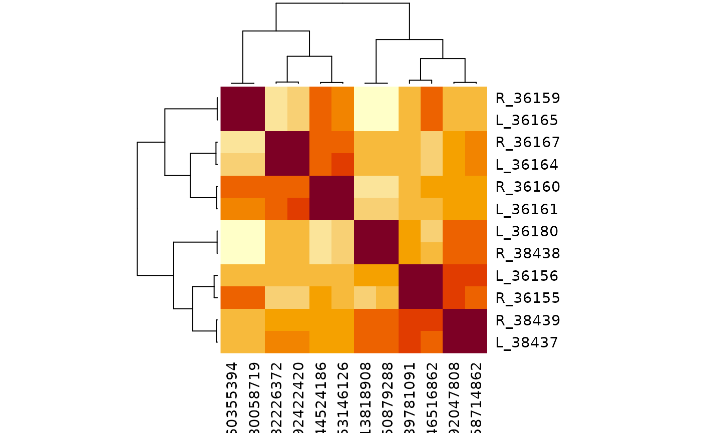
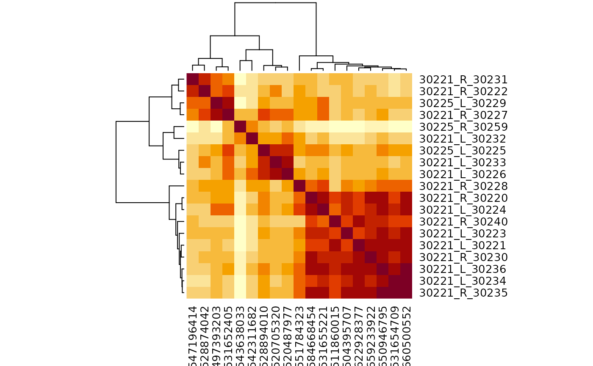

# Connectivity Clustering with Predicted Groups

This vignette clusters a set of related Aedes neurons by their
connectivity using [coconatfly](https://natverse.org/coconatfly)’s
[`cf_cosine_plot()`](https://natverse.org/coconatfly/reference/cf_cosine_plot.html).
Cosine clustering compares neurons by the partners they share, and those
partners must first be grouped, so that e.g. two neurons that each
contact a different member of the same partner cell type still count as
similar.

In well annotated datasets partners are grouped by cell `type`. Most
aedes neurons do not yet have a type, so we compare two alternatives:

- `group`: the curated group (see
  [`aedes_set_group()`](../reference/aedes_set_group.md)).
- `pgroup`: the predicted group from
  [`aedes_predict_group()`](../reference/aedes_predict_group.md), which
  uses the first available of cell type, curated `group` and NBLAST
  cluster.

The chunks below need FlyTable and CAVE access. They are evaluated when
the pkgdown website is built; elsewhere saved results are shown instead
(see [Rerunning this vignette](#rerunning-this-vignette)).

``` r

library(aedes)
library(coconatfly)
library(dplyr)
register_aedes_coconat()
```

## Quick start

Once
[`register_aedes_coconat()`](../reference/register_aedes_coconat.md) has
been called, coconatfly metadata for aedes neurons includes a `pgroup`
column, so you can simply choose the grouping column:

``` r

cf_cosine_plot(cf_ids(aedes = "group:36155"), group = "group")
cf_cosine_plot(cf_ids(aedes = "group:36155"), group = "pgroup")
```

## Fetch the connectivity once

As an example we use the 12 untyped visual projection neurons in group
36155. Rather than letting
[`cf_cosine_plot()`](https://natverse.org/coconatfly/reference/cf_cosine_plot.html)
fetch connectivity each time, we fetch a connection table once with
`group = FALSE` and then cluster it with different grouping columns.

``` r

ids <- cf_ids(aedes = "group:36155")
cf_meta(ids) %>% select(id, serial_id, side, group, nblast_group)
#>                    id serial_id side group nblast_group
#> 1  648518347546516862     36155    R 36155        36155
#> 2  648518347589781091     36156    L 36155        36155
#> 3  648518347560355394     36159    R 36155        36155
#> 4  648518347544524186     36160    R 36155        36155
#> 5  648518347553146126     36161    L 36155        36155
#> 6  648518347592422420     36164    L 36155        36155
#> 7  648518347480058719     36165    L 36155        36155
#> 8  648518347482226372     36167    R 36155        36155
#> 9  648518347513818908     36180    L 36155        36155
#> 10 648518347558714862     38437    L 36155        36155
#> 11 648518347650879288     38438    R 36155        36155
#> 12 648518347592047808     38439    R 36155        36155

x <- multi_connection_table(ids, partners = c("in", "out"), threshold = 5,
                            group = FALSE)
#> Warning in fafbseg::cam_meta(ids = ids, ignore.case = ignore.case, fixed = fixed, : Dropping 1 rows containing duplicate root_ids!
#> You can inspect all 2 rows with duplicate ids by doing:
#> attr(df, 'duprows')
#> on your returned data frame (replacing df as appropriate).
```

Partner neurons without a label in the chosen column cannot act as
shared features and are dropped. We can check what fraction of the
partner synapses each column covers:

``` r

cov <- x %>%
  group_by(partners) %>%
  summarise(type = sum(weight[!is.na(type)]) / sum(weight),
            group = sum(weight[!is.na(group)]) / sum(weight),
            pgroup = sum(weight[!is.na(pgroup)]) / sum(weight)) %>%
  mutate(across(-partners, ~ round(.x, 3))) %>%
  as.data.frame()
cov
#>   partners  type group pgroup
#> 1   inputs 0.002 0.161  0.161
#> 2  outputs 0.008 0.613  0.621
```

Cell types cover under 1% of partner synapses, so `group = "type"` is
not useful here. Using `pgroup` rather than `group` raises coverage of
output synapses from 61% to 62%. Input coverage stays low because most
of the input partners are not yet in FlyTable at all.

## Cluster by curated group

``` r

cf_cosine_plot(x, group = "group", labRow = "{side}_{serial_id}")
#> Warning in coconat::partner_summary2adjacency_matrix(x[["outputs"]], inputcol =
#> "pre_key", : Dropping: 1092/1715 neurons representing 11475/29629 synapses due
#> to missing ids!
#> Warning in coconat::partner_summary2adjacency_matrix(x[["inputs"]], inputcol =
#> groupcol, : Dropping: 4259/4477 neurons representing 49907/59475 synapses due
#> to missing ids!
```


## Cluster by predicted group

``` r

cf_cosine_plot(x, group = "pgroup", labRow = "{side}_{serial_id}")
#> Warning in coconat::partner_summary2adjacency_matrix(x[["outputs"]], inputcol =
#> "pre_key", : Dropping: 1078/1715 neurons representing 11240/29629 synapses due
#> to missing ids!
#> Warning in coconat::partner_summary2adjacency_matrix(x[["inputs"]], inputcol =
#> groupcol, : Dropping: 4256/4477 neurons representing 49877/59475 synapses due
#> to missing ids!
```



At the time of writing (September 2026) both groupings split the 12
neurons into six left/right pairs, which is reassuring. With `pgroup`
the extra partner information gave a crisper result: 36155/36156 and
38437/38439 separated cleanly into two pairs rather than forming one
loosely resolved cluster of four.

## How the predicted group is defined

[`aedes_predict_group()`](../reference/aedes_predict_group.md) returns
ids that all live in the `serial_id` namespace, taking the first of
these that is available:

1.  **type**: the smallest `serial_id` among neurons of that type (a
    trailing `?` is ignored, as are uninformative types listed in
    `badtypes`).
2.  **group**: the curated `group`.
3.  **nblast_group**: clusters of the form `CNNNNN` or `NNNNN`, where
    `NNNNN` is the smallest `serial_id` in the cluster (surrounding
    whitespace and a trailing `?` are ignored). Any other value is
    ignored, so a bad cluster can be struck out by prefixing it with `X`
    (e.g. `XC12345`) without deleting the information.

Neurons with none of these get `NA` and are dropped as partners. With
`singletons = TRUE` they instead fall back to their own `serial_id`,
i.e. a group of one, so that every partner in FlyTable keeps its
connectivity as a feature, behaving like `group = FALSE` for that
neuron. This is off by default because a singleton partner can only be
shared by neurons on the same side of the brain, which tends to pull
left/right homologues apart.

Because type-derived ids use the smallest `serial_id` among the rows
supplied, they can depend on which neurons are in the table. Within one
[`cf_cosine_plot()`](https://natverse.org/coconatfly/reference/cf_cosine_plot.html)
call the partner metadata for each direction is fetched together, so the
ids are consistent where it matters.

You can also compute predicted groups yourself, e.g. to use a custom
`badtypes` list:

``` r

x$pgroup2 <- aedes_predict_group(x, badtypes = c(NA, "", "undefined"))
cf_cosine_plot(x, group = "pgroup2", labRow = "{side}_{serial_id}")
#> Warning in coconat::partner_summary2adjacency_matrix(x[["outputs"]], inputcol =
#> "pre_key", : Dropping: 1078/1715 neurons representing 11240/29629 synapses due
#> to missing ids!
#> Warning in coconat::partner_summary2adjacency_matrix(x[["inputs"]], inputcol =
#> groupcol, : Dropping: 4256/4477 neurons representing 49877/59475 synapses due
#> to missing ids!
```


## Advanced: splitting ipsilateral and contralateral connectivity

Grouping partners by `pgroup` ignores which side of the brain they are
on, so a neuron that contacts the left-side members of a partner group
looks the same as one that contacts the right-side members. We do not
normally want to separate partners by side (after all, this is precisely
how connectivity clustering can identify left-right homologues), but for
bilateral neurons it may be useful to distinguish ipsilateral from
contralateral connectivity. This could be important e.g. for bilateral
inhibitory neurons involved in steering.

To keep the side information, we can give each partner group two labels,
depending on whether the partner is on the same side of the brain as the
query neuron (`NNNNNi`, ipsilateral) or on the opposite side (`NNNNNc`,
contralateral).

As an example we use the 19 lateral horn local neurons (class `LHLN`) in
groups 30221 (16 bilateral, subclass `BR`) and 30225 (3 unilateral,
subclass `IR`). These were originally annotated as two groups but do not
split cleanly along those lines. Connections among the query neurons
themselves can dominate the comparison when they are heavily
interconnected, as these are, so we drop those first.

``` r

ids_lh <- cf_ids(aedes = "group:30221|30225")
x_lh <- multi_connection_table(ids_lh, threshold = 5, group = FALSE)

qkeys <- keys(ids_lh)
qside <- cf_meta(ids_lh) %>% select(query_key = key, query_side = side)

x_lr <- x_lh %>%
  # drop connections among the query neurons
  filter(!(pre_key %in% qkeys & post_key %in% qkeys)) %>%
  # the query neuron is postsynaptic for inputs, presynaptic for outputs
  mutate(query_key = if_else(partners == "inputs", post_key, pre_key)) %>%
  left_join(qside, by = "query_key") %>%
  mutate(
    lat = case_when(!side %in% c("L", "R") | !query_side %in% c("L", "R") ~ NA,
                    side == query_side ~ "i",
                    .default = "c"),
    # keep NA so that unlabelled partners are dropped, not pooled
    pgroup_lr = if_else(is.na(pgroup) | is.na(lat), NA, paste0(pgroup, lat)))
x_lr
#> # A tibble: 281 × 52
#>    post_id  pre_id weight supervoxel_id serial_id point_xyz side  class subclass
#>    <int64> <int64>  <int> <chr>         <chr>     <chr>     <chr> <chr> <chr>   
#>  1    6e17    6e17     93 741706516442… 11451     17815,18… R     cb_i… ALPN    
#>  2    6e17    6e17     64 755076577165… 10959     27167.48… L     cb_i… ALPN    
#>  3    6e17    6e17     63 755076577164… 10957     27182.10… L     cb_i… ALPN    
#>  4    6e17    6e17     60 742410203885… 11419     17934,17… R     cb_i… ALPN    
#>  5    6e17    6e17     54 742410203885… 11419     17934,17… R     cb_i… ALPN    
#>  6    6e17    6e17     54 742410203885… 11419     17934,17… R     cb_i… ALPN    
#>  7    6e17    6e17     54 741706516442… 11451     17815,18… R     cb_i… ALPN    
#>  8    6e17    6e17     53 755076577165… 10959     27167.48… L     cb_i… ALPN    
#>  9    6e17    6e17     50 755076577165… 10959     27167.48… L     cb_i… ALPN    
#> 10    6e17    6e17     40 755076577165… 10959     27167.48… L     cb_i… ALPN    
#> # ℹ 271 more rows
#> # ℹ 43 more variables: type <chr>, group <chr>, nblast_group <chr>,
#> #   notes <chr>, proofreader <chr>, annotator <chr>, lineage <chr>,
#> #   neuropils <chr>, status <chr>, axon_tract <chr>,
#> #   neurotransmitter_verified <chr>, neurotransmitter_verified_source <chr>,
#> #   soma_xyz <chr>, nucleus_id <dbl>, birthtime <chr>, nerve <chr>,
#> #   lrcid <chr>, synonyms <chr>, flywire_type <chr>, instance <chr>, …
```

`multi_connection_table(group = FALSE)` returns one row per connection
between a query neuron and a partner, with the partner’s metadata
(including `side` and `pgroup`). The `partners` column says whether the
partner is an input or an output, and therefore whether the query neuron
is in `post_key` or `pre_key`; we use that to look up the query neuron’s
soma side. Comparing the two sides gives an `i` or `c` suffix for the
partner’s `pgroup`, so each partner group becomes two separate features.

Partners with no `pgroup` or no L/R side must stay `NA`, so that they
are dropped like any other unlabelled partner. Pasting a suffix onto
`NA` would make a string such as `"NAc"`, merging every unlabelled
partner into one fake shared group that inflates similarity.

We then cluster on the new column, labelling each neuron with its
curated group so we can see how the two groups mix:

``` r

cf_cosine_plot(x_lr, group = "pgroup_lr",
               labRow = "{group}_{side}_{serial_id}")
#> Warning in coconat::partner_summary2adjacency_matrix(x[["outputs"]], inputcol =
#> "pre_key", : Dropping: 83/195 neurons representing 701/1828 synapses due to
#> missing ids!
#> Warning in coconat::partner_summary2adjacency_matrix(x[["inputs"]], inputcol =
#> groupcol, : Dropping: 27/86 neurons representing 200/1540 synapses due to
#> missing ids!
```



Note that “side” means soma side. For bilateral neurons, an `i` partner
shares the query neuron’s soma side; that says nothing about where on
the query neuron the synapse is. It is worth checking how much of the
connectivity the split actually affects:

``` r

lr_wt <- x_lr %>%
  filter(!is.na(pgroup_lr)) %>%
  count(partners, lat, wt = weight) %>%
  as.data.frame()
lr_wt
#>   partners lat    n
#> 1   inputs   c   21
#> 2   inputs   i 1319
#> 3  outputs   c  256
#> 4  outputs   i  871
```

At the time of writing (November 2026) only 277 of the 2467 synapses
with labelled partners were contralateral, almost all of them outputs,
so the split changes the clustering only modestly here.

## Rerunning this vignette

The results above depend on the live FlyTable annotations and CAVE
connectivity, so they will change as proofreading and annotation
progress.

- **Website.** The pkgdown GitHub Actions workflow has the necessary
  FlyTable and CAVE credentials and evaluates this vignette in full
  whenever the site is rebuilt and deploys it on every push to `main`
  (pull requests also build the site, but do not deploy it). To refresh
  it without a push, trigger the workflow manually from the repository’s
  Actions tab or with `gh workflow run pkgdown.yaml`.

- **Locally.** With FlyTable and CAVE access set up, render the vignette
  with the live chunks enabled:

  ``` r

  Sys.setenv(AEDES_LIVE_VIGNETTES = "true")
  rmarkdown::render("vignettes/connectivity-clustering.Rmd")
  ```

- **Saved results.** When not evaluated live (e.g. during `R CMD check`
  or
  [`vignette("connectivity-clustering")`](../articles/connectivity-clustering.md)
  from an installed package) the saved figures in `vignettes/figures/`
  are shown. To refresh them, also set
  `AEDES_SAVE_VIGNETTE_FIGURES=true` when rendering locally, then update
  the saved coverage and weight tables and the “at the time of writing”
  text to match.
