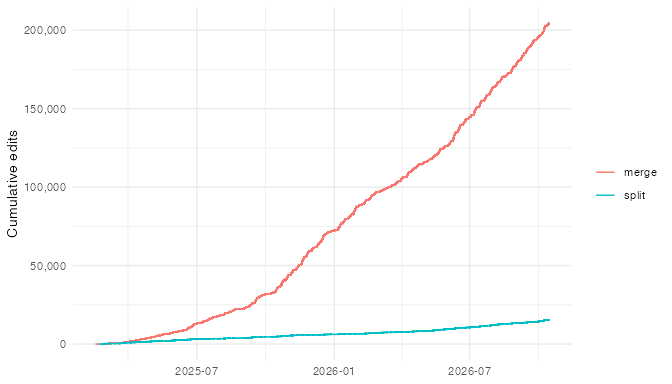
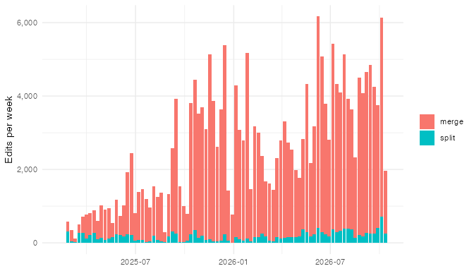

# Proofreading Edit History

This vignette summarises the history of proofreading edits in the Aedes
connectome. Every merge or split made in the segmentation is recorded as
an operation by the CAVE chunkedgraph, along with a timestamp and the id
of the user who made it.

The chunks below need CAVE access and a populated local edit cache. They
are only evaluated when the vignette is rebuilt locally; elsewhere saved
results are shown instead (see [Rerunning this
vignette](#rerunning-this-vignette)).

## Fetching the edit history

`aedes:::aedes_all_operations()` finds the most recent operation id and
then fetches details for every operation up to that point. Results are
cached on disk (in `rappdirs::user_cache_dir("aedes")`), so only new
operations are fetched on subsequent calls. The first call takes several
hours.

``` r

library(aedes)
library(dplyr)
library(ggplot2)
ops <- aedes:::aedes_all_operations()
```

One user account (`8041`, `BANCautomerge`) carried out an automated
batch of about 75,000 merges over a few days in September 2025, peaking
at over 10,000 edits per hour. These corresponded to merges of the
nucleus into the main part of the segmentation, based on analysis by
Dana Sherman of the nuclear segmentation provided by Zetta. These are
excluded so that the plots reflect human proofreading. We also keep only
operations that completed successfully (`operation_status` 0).
Operations that remove edges are splits; all others are merges.

``` r

auto_users <- 8041
edits <- ops %>%
  filter(!.data$user %in% auto_users, .data$operation_status == 0) %>%
  mutate(type = ifelse(is.na(.data$removed_edges) |
                         .data$removed_edges == "NA", "merge", "split")) %>%
  arrange(.data$timestamp)

edit_summary <- edits %>%
  summarise(n = n(), users = n_distinct(.data$user),
            first = as.Date(min(.data$timestamp)),
            last = as.Date(max(.data$timestamp)))
edit_summary
```

    #>        n users      first       last
    #> 1 219858    39 2025-02-15 2026-10-15

## Cumulative edits

``` r

p_cum <- edits %>%
  group_by(.data$type) %>%
  mutate(n = row_number()) %>%
  ggplot(aes(.data$timestamp, .data$n, colour = .data$type)) +
  geom_step() +
  scale_y_continuous(labels = scales::label_comma()) +
  labs(x = NULL, y = "Cumulative edits", colour = NULL) +
  theme_minimal()
p_cum
ggsave("figures/edits-cumulative.png", p_cum, width = 7, height = 4, dpi = 96,
       bg = "white")
```



## Edits per week

``` r

p_week <- edits %>%
  mutate(week = as.Date(cut(.data$timestamp, "week"))) %>%
  count(.data$week, .data$type) %>%
  ggplot(aes(.data$week, .data$n, fill = .data$type)) +
  geom_col() +
  scale_y_continuous(labels = scales::label_comma()) +
  labs(x = NULL, y = "Edits per week", fill = NULL) +
  theme_minimal()
p_week
ggsave("figures/edits-weekly.png", p_week, width = 7, height = 4, dpi = 96,
       bg = "white")
```



## Rerunning this vignette

To update the figures with the latest edits, rebuild the vignette from
the `vignettes/` directory on a machine with CAVE access:

``` r

withr::with_envvar(c(AEDES_LIVE_VIGNETTES = "true"), {
  rmarkdown::render("edit-history.Rmd", output_dir = tempdir())
})
```

This tops up the local edit cache and overwrites the PNGs in
`vignettes/figures/`. Then copy the printed `edit_summary` values into
the `tidy-saved` chunk and commit the updated figures.
